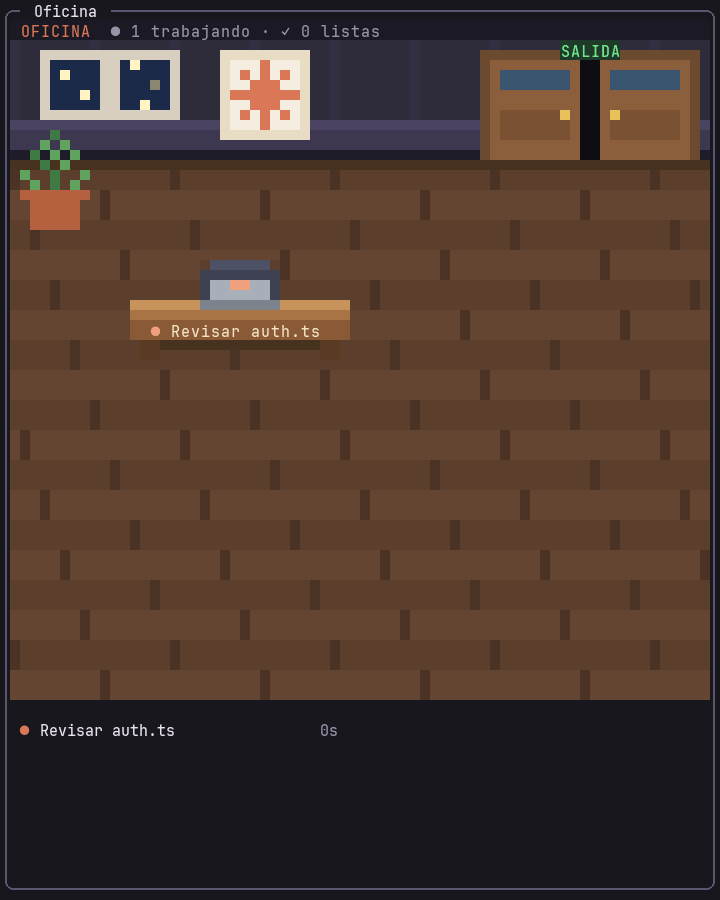
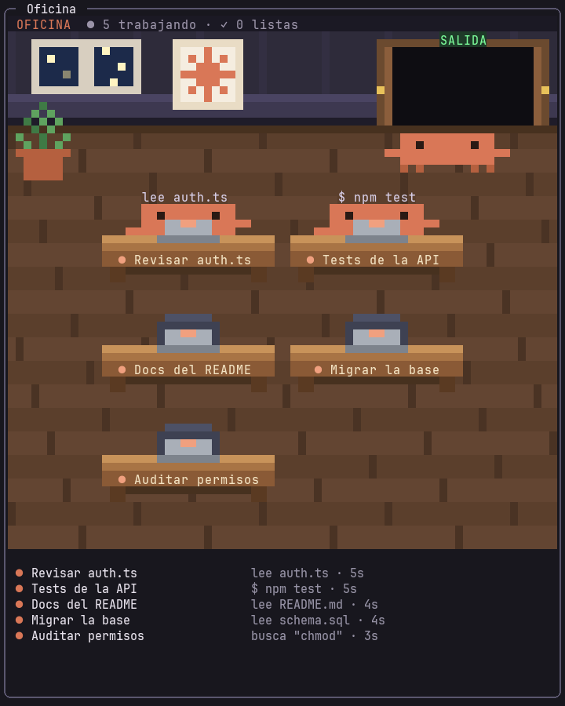
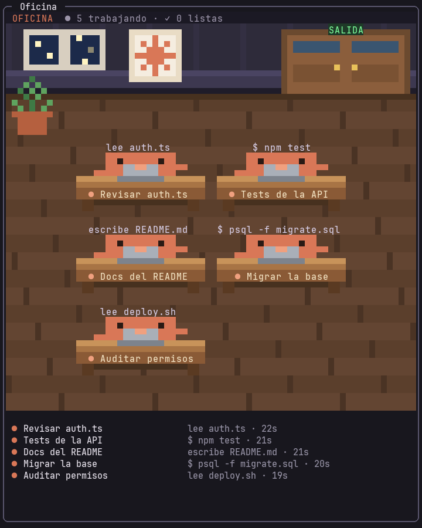
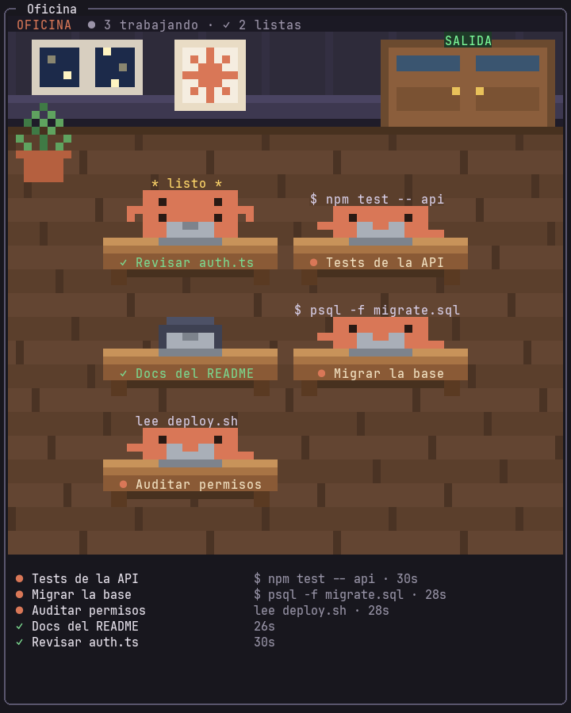
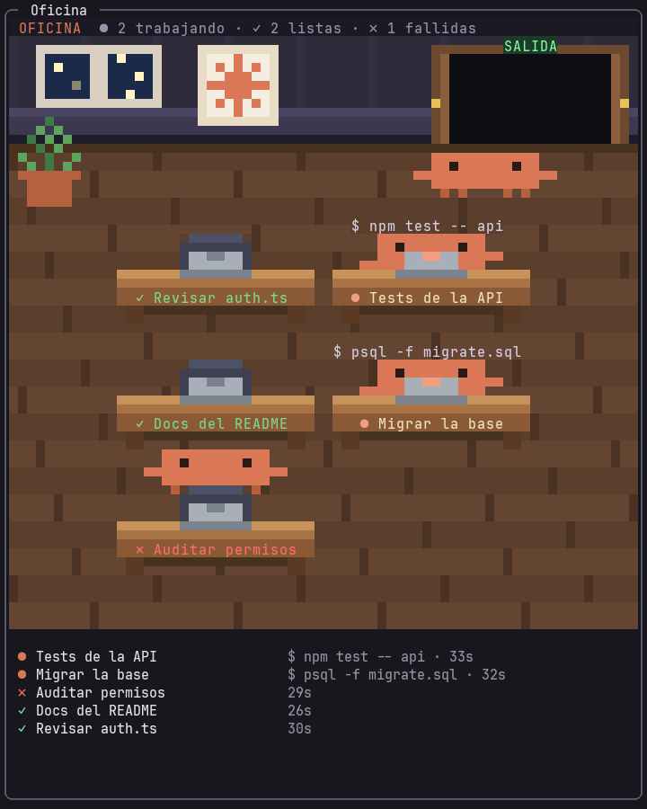

# 🏢 Oficina — tus agentes de Claude Code, trabajando en pixel art

Un mod para [Claude Code](https://claude.com/claude-code) que convierte el trabajo de tus subagentes y workflows en una oficina animada, dentro de la misma terminal.

Cada agente es un **Clawd** naranja, la mascota de Claude Code. Entra por la puerta, camina hasta un escritorio con el nombre de su tarea, se sienta a teclear y, al terminar, marca la tarea como hecha y sale por la puerta.



## Qué hace

- **Se abre sola** en una franja lateral (35% del ancho) cuando arranca el primer agente, y **se cierra sola** cuando se van todos.
- **Un Clawd por agente**: subagentes (herramienta Agent), agentes de workflows y compañeros de equipo (teammates).
- **Cada escritorio lleva el nombre de la tarea** en el frente, y sobre la cabeza del Clawd se ve lo que está haciendo en ese momento: `lee auth.ts`, `$ npm test`, `edita README.md`…
- **Al terminar**, la tarea se marca con ✓ verde, el Clawd salta de alegría y sale por la puerta. Si la tarea falla, se marca con ✗ rojo.
- **Puerta con turnos**: los Clawds entran y salen de uno en uno. Si no hay escritorio libre, esperan su turno (`+N en espera`).
- **Teammates en pausa**: un compañero de equipo que espera mensajes dormita en su escritorio (`z z z`).
- **Lista bajo la escena** con el nombre completo de cada tarea, lo que hace y cuánto lleva.

## Capturas

| Llegando | Trabajando |
| --- | --- |
|  |  |
| **Terminando** | **Saliendo** |
|  |  |

> Las imágenes se generaron a partir de la salida real del mod: la misma cuadrícula de celdas de colores que recibe la terminal, dibujada con una fuente monoespaciada.

## Instalación

Necesitas Claude Code con soporte de mods (probado en la versión 2.1.303).

Escribe esto en el prompt de una sesión de Claude Code en la terminal:

```
/plugin install oficina --marketplace waldooCreator/claude-code-oficina
```

Responde `y` para agregar el marketplace y elige el alcance **user** (el primero, con Enter). Así queda activo en todas tus sesiones, en cualquier carpeta.

Desde una terminal normal (fuera de Claude Code):

```bash
claude plugin install oficina --marketplace waldooCreator/claude-code-oficina
```

En la app de escritorio, donde `/plugin` no está disponible: haz clic en **+** junto al cuadro del prompt, luego **Plugins**, **Add marketplace** con `waldooCreator/claude-code-oficina` y después **Add plugin**.

### Probarlo sin instalar

```bash
git clone https://github.com/waldooCreator/claude-code-oficina.git
claude --plugin-dir ./claude-code-oficina
```

## Uso

No hay que hacer nada: cuando Claude lanza agentes, la oficina aparece sola.

| Comando | Qué hace |
| --- | --- |
| `/oficina` | Abre o cierra la oficina |
| `/oficina limpiar` | Vacía la oficina (si quedó algún agente colgado) |

### Para que aparezca como franja lateral

- **Usa la pantalla completa de la terminal.** Claude Code solo acopla paneles al costado en ese modo. En el modo normal (por ejemplo dentro de tmux), la oficina no se abre sola: abajo aparece el aviso `🏢 Agentes trabajando · /oficina para ver la oficina`, y con `/oficina` se abre encima del prompt.
- **Ancho de la terminal.** Claude Code solo abre paneles por su cuenta desde **144 columnas**. Si tu terminal es más angosta, ábrela una vez con `/oficina`; desde entonces se abrirá sola desde 110 columnas.
- Si cierras la oficina mientras hay agentes trabajando, no se vuelve a abrir hasta el siguiente grupo de agentes.

## Cómo funciona

El mod se engancha a los eventos de Claude Code:

- `agent.spawn`: llega un agente nuevo (subagente, workflow o teammate).
- `tool.call`: qué está haciendo cada agente.
- `turn.complete`: un agente terminó (✓ si respondió, ✗ si falló o se interrumpió).
- `$.agent.list()`, consultado cada 2 s: detecta agentes detenidos o que desaparecieron sin avisar.

La escena es un `Raster`: una cuadrícula de celdas donde cada celda usa el carácter `▀` con un color arriba y otro abajo, así que cada celda da dos píxeles cuadrados. Se repinta unas 11 veces por segundo con `$.ui.blit`, sin redibujar el resto de la interfaz.

En la app de escritorio (y en el editor y el teléfono) no existe `Raster`: ahí la misma escena se dibuja como `Svg`, un píxel por unidad, y el panel se redibuja en cada paso de la animación (el motor lo limita a 10 veces por segundo).

```
hooks/register.tsx   los hooks: sigue a los agentes y abre o cierra el panel
hooks/scene.ts       la oficina: simulación, sprites y pintado en celdas
types/index.d.ts     el estado que guarda la lista de agentes
tests/               pruebas (claude plugin test)
```

## Desarrollo

```bash
claude plugin validate .   # valida el manifiesto y los hooks
claude plugin test .       # corre las pruebas
claude --plugin-dir .      # abre una sesión con el mod cargado desde esta carpeta
```

## Aviso

Proyecto personal, **no oficial**: no está afiliado a Anthropic ni cuenta con su respaldo. Clawd y Claude son de Anthropic.

## Licencia

[MIT](LICENSE)
